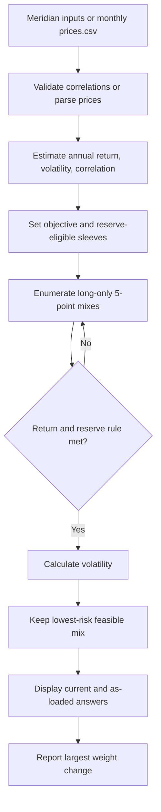

# Lab 15 — Portfolio Stability Decision

## Decision frame

The decision user is the Meridian Foundation CIO. The action is to identify a **starting allocation for review**, not to adopt an allocation automatically, for the $100 million reserve over its seven-year horizon with annual rebalancing. The baseline is the Lab 14 benchmark: 40% investment-grade bonds and 60% global equity. The provisional objective is 6.5% expected annual return (CPI + 4%, using the labelled 2.5% CPI estimate). Hard boundaries are long-only allocation, no derivatives, at least 3% in reserve-eligible sleeves, at least 90% redeemable within five business days, an 8% single-company limit, and turnover approval above 25%.

The Meridian inputs are course-authored annual training estimates, not forecasts or market data. A personal CSV, when supplied, is monthly adjusted-close prices with the date column first and oldest month first. The app converts simple monthly price returns to arithmetic mean × 12, sample standard deviation × sqrt(12), and correlations. Those historical estimates are labelled estimates, not forecasts.

## Engine and app

`portfolio.py` keeps its Lab 14 command-line output unchanged and adds:

- `find_lowest_risk_mix`: enumerates every long-only 5-point grid mix, retains mixes meeting the return objective and reserve floor, then selects the least volatile;
- `estimate_from_prices`: estimates return, volatility, and correlation from all monthly returns or the latest 36 return observations.

`app.py` imports these functions and the Meridian inputs rather than copying the mathematics. Run it from this folder after installing the listed dependency:

```sh
python -m pip install -r requirements.txt
streamlit run app.py
```



## Validation and stability tests

The expected directions were set before the checks: lowering equity's expected return should make the optimizer need more equity to hit the target; raising the IG–equity correlation should make the prior bond diversification less useful; and an infeasible target should yield no allocation instead of silently changing the mandate.

| Test | Predicted direction | Actual result | Interpretation |
|---|---|---|---|
| Meridian inputs, 6.5% objective, 3% reserve floor | Feasible minimum-risk grid portfolio | Bills / 10-year / IG / equity = **0 / 20 / 25 / 55**; return **6.51%**; volatility **9.44%** | Reconciles to the stated known answer. Weights sum to 100% and reserve eligibility is 20%. |
| Change only equity expected return from 8.0% to 7.0% | More equity needed to clear objective, hence higher risk | **0 / 10 / 10 / 80**; return **6.53%**; volatility **12.94%** | Largest weight change is **25 points**. A one-point estimate revision materially changes the recommendation. |
| Change IG–equity correlation symmetrically from 0.25 to 0.50, then restore it | Less bond/equity diversification; the lowest-risk mix changes | **0 / 40 / 0 / 60**; return **6.52%**; volatility **9.73%** | Covariance matters: a correlation estimate alone changes the grid answer. Restoring 0.25 restores the base inputs. |
| Set objective above the maximum sleeve return (for example, 8.5%) | No feasible long-only mix | “No mix meets the objective.” | The app does not lower the objective or create leverage to manufacture an answer. |

The app reports gross, pre-cost estimates because the supplied Meridian inputs are gross classroom mechanics values. No cost or turnover model is present, so costs are not netted; this is a limitation and an adoption blocker rather than an omitted fact. The Lab 13 liquidity, concentration, loss-rule, and turnover constraints are not optimized by this four-sleeve classroom grid and must be checked separately.

## Project 2 universe, sources, and window test

The uploaded universe is QQQ, SPY, NVDA, and VOO. `prices.csv` contains their monthly **adjusted-close** prices with the date first and oldest month first. It has 60 month-end observations from 2021-11-01 through 2026-10-01 (therefore 59 monthly return observations). The source for every ticker was **Yahoo Finance**, downloaded through `yfinance` on **2026-10-22**.

| Ticker | Instrument | Price source | Download date |
|---|---|---|---|
| QQQ | Invesco QQQ Trust | Yahoo Finance adjusted close | 2026-10-22 |
| SPY | SPDR S&P 500 ETF Trust | Yahoo Finance adjusted close | 2026-10-22 |
| NVDA | NVIDIA Corporation | Yahoo Finance adjusted close | 2026-10-22 |
| VOO | Vanguard S&P 500 ETF | Yahoo Finance adjusted close | 2026-10-22 |

Because this supplied universe contains no reserve asset, the documented exercise constraint is **0% reserve-eligible weight**; setting Meridian's 3% reserve floor would honestly produce no feasible mix. Until a different Project 2 mandate is supplied, the exercise retains Meridian's 6.5% objective only as a labelled training objective, not as a client forecast or mandate assertion.

| Window | Annualized arithmetic return estimates: QQQ / SPY / NVDA / VOO | Lowest-risk feasible 5-point mix: QQQ / SPY / NVDA / VOO | Return | Volatility |
|---|---|---:|---:|---:|
| All 59 monthly returns | 14.69% / 13.09% / 50.34% / 13.14% | **0 / 75 / 0 / 25** | **13.11%** | **15.56%** |
| Last 36 monthly returns | 25.54% / 22.15% / 62.77% / 22.23% | **0 / 100 / 0 / 0** | **22.15%** | **12.25%** |

The largest all-month versus last-36 weight change is **75 points** (SPY rises from 75% to 100%; VOO falls from 25% to 0%). The results are historical arithmetic-return estimates, not forecasts. This large difference is a window-selection warning, especially because SPY and VOO are near substitutes that both track the S&P 500.

## Partner attack and decision

**Partner attack:** A skeptical reviewer changed the equity return estimate from 8.0% to 7.0%. The answer shifted 25 points toward equity because the optimizer needs a larger allocation to the lower-return sleeve to satisfy the same 6.5% floor; its volatility rose from 9.44% to 12.94%. In the QQQ/SPY/NVDA/VOO universe, the 75-point window change is the more material warning: changing from all available months to the latest 36 selects 100% SPY rather than a 75% SPY / 25% VOO split.

**Decision:** Reject the QQQ/SPY/NVDA/VOO result as an adoptable allocation and use it only as a pilot calculation. I would reconsider once the mandate supplies a genuine reserve sleeve and net-of-costs objective, avoids overlapping S&P 500 exposures unless intentional, defines the calendar-year loss rule and breach response, and passes a window/estimate/cost test without a material allocation change.

## AI use, no-AI transfer, and growth note

AI was used to help implement the grid search, CSV estimator, Streamlit controls, and documentation. I accepted the reusable calculation structure, but rejected treating any displayed optimum as an investment recommendation: the result is conditional on estimates and incomplete mandate inputs.

**No-AI transfer:** An optimizer amplifies expected-return errors because the target is a hard cutoff. When equity's expected return fell one point, the prior mix no longer cleared 6.5%, so the discrete five-point search moved 25 percentage points to equity to cross the threshold; it then accepted higher volatility because feasibility comes before risk minimization.

I can now trace a portfolio app from monthly prices through annualized estimates, covariance, constraints, and a grid-search decision, and I can test whether the result is stable. I still need more confidence in point-in-time inputs, cost modelling, and a complete mandate before I could defend adoption.
