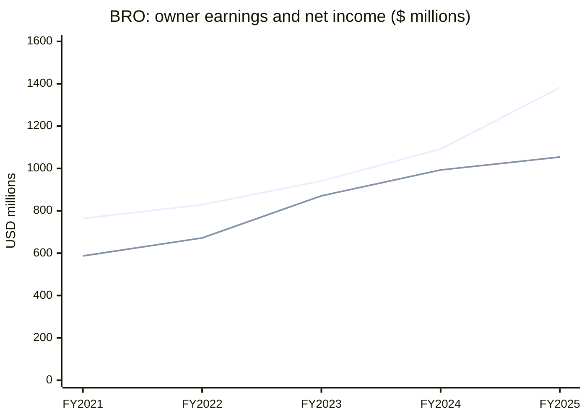

# BRO — Buffett EDGAR Run Evidence

**Run date:** 3 November 2026

**Ticker:** BRO (Brown & Brown, Inc.)

**Data source:** SEC EDGAR company facts, 10-K annual facts only

**Scope:** Business-quality teaching demonstration; no price data, valuation, forecast, or investment advice.

## Executive summary

The fixed review returns **watch it** for BRO. Owner earnings were positive in every displayed year and increased from the first year to the last. The ROE check is **not known** because equity is `not found` in the latest two displayed years; the program preserves that limitation rather than estimating a value.

## Rendered app chart

## 10-K fact table

All amounts are USD millions; the latest 10-K filing wins for a duplicated fiscal-year period.

| Fiscal year end | Revenue | Net income | Operating cash flow | Capital spending | Equity | ROE | Owner earnings |
|---|---:|---:|---:|---:|---:|---:|---:|
| 2021-12-31 | 3,051 | 587 | 809 | 45 | 4,197 | 14.0% | 764 |
| 2022-12-31 | 3,573 | 672 | 881 | 52 | 4,607 | 14.6% | 829 |
| 2023-12-31 | 4,257 | 871 | 1,010 | 69 | 5,579 | 15.6% | 941 |
| 2024-12-31 | 4,805 | 993 | 1,174 | 82 | not found | not known | 1,092 |
| 2025-12-31 | 5,902 | 1,054 | 1,450 | 68 | not found | not known | 1,382 |

**XBRL tags used:** revenue — `Revenues`; net income — `NetIncomeLoss`; operating cash flow — `NetCashProvidedByUsedInOperatingActivities`; capital spending — `PaymentsToAcquirePropertyPlantAndEquipment`; equity — `StockholdersEquity` when present.

## Fixed Buffett checks

| Check | Result |
|---|---|
| ROE of 15% or more every year | **not known** |
| Owner earnings positive every year | **pass** |
| Owner earnings grew, first year to last | **pass** |

## Memo rendered in the app

> **Verdict: watch it.** Owner earnings were positive in every reported year and increased from 764 to 1,382. The script reports equity as `not found` in the latest two displayed years, so it returns `not known` rather than an ROE pass.

## Memo-number audit

**Rendered result:** `Every number in this memo appears in the script's computed table.`

An injected `40.0%` is flagged because it does not appear in the computed table.

**Primary sources:** [SEC ticker-to-CIK file](https://www.sec.gov/files/company_tickers.json) and [BRO company facts](https://data.sec.gov/api/xbrl/companyfacts/CIK0000079282.json).
