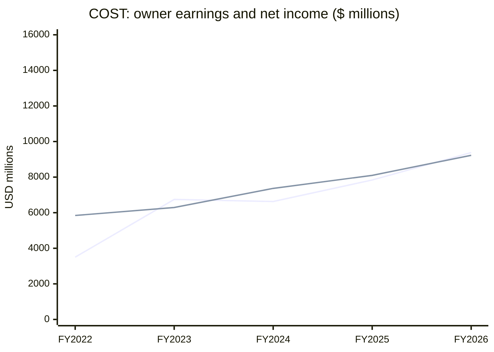

# COST — Buffett EDGAR Run Evidence

**Run date:** 3 November 2026

**Ticker:** COST (Costco Wholesale Corporation)

**Data source:** SEC EDGAR company facts, 10-K annual facts only
**Scope:** Business-quality teaching demonstration; no price data, valuation, forecast, or investment advice.

---

## Executive summary

The fixed code review returned **own the business** for COST. All three
predefined checks passed: ROE was at least 15% in every displayed fiscal year,
owner earnings were positive in every year, and owner earnings increased from
the first displayed year to the last.

## Rendered app chart

## 10-K fact table

All amounts are USD millions. The program selected the latest 10-K filing when
the same fiscal-year period appeared more than once.

| Fiscal year end | Revenue | Net income | Operating cash flow | Capital spending | Equity | ROE | Owner earnings |
|---|---:|---:|---:|---:|---:|---:|---:|
| 2022-08-28 | 226,954 | 5,844 | 7,392 | 3,891 | 20,642 | 28.3% | 3,501 |
| 2023-09-03 | 242,290 | 6,292 | 11,068 | 4,323 | 25,058 | 25.1% | 6,745 |
| 2024-09-01 | 254,453 | 7,367 | 11,339 | 4,710 | 23,622 | 31.2% | 6,629 |
| 2025-08-31 | 275,235 | 8,099 | 13,335 | 5,498 | 29,164 | 27.8% | 7,837 |
| 2026-08-30 | 303,154 | 9,226 | 15,817 | 6,435 | 35,803 | 25.8% | 9,382 |

**XBRL tags used:** revenue — `RevenueFromContractWithCustomerExcludingAssessedTax`; net income — `NetIncomeLoss`; operating cash flow — `NetCashProvidedByUsedInOperatingActivities`; capital spending — `PaymentsToAcquirePropertyPlantAndEquipment`; equity — `StockholdersEquity`.

## Fixed Buffett checks

| Check | Result |
|---|---|
| ROE of 15% or more every year | **pass** |
| Owner earnings positive every year | **pass** |
| Owner earnings grew, first year to last | **pass** |

## Memo rendered in the app

> **Verdict: own the business.** The operating record clears all three fixed
> checks: ROE stayed above the required threshold in every reported fiscal year,
> owner earnings were positive throughout, and owner earnings rose from 3,501 to
> 9,382.
>
> The record is not perfectly smooth: owner earnings moved from 6,745 down to
> 6,629 before resuming their increase. Still, the combination of consistently
> strong ROE and larger owner earnings at the end of the reported period supports
> owning the business on operating quality. This is a business judgment only; it
> says nothing about a share price or purchase price.

## Memo-number audit

**Rendered result:** `Every number in this memo appears in the script's computed table.`

The app was also tested by adding `40.0%` to the memo. It flagged that value
because it does not appear in the computed table. This verifies the audit is a
real check rather than a pasted success message.

## Validation notes

- The live Streamlit COST run displayed the chart, fact table, checks, memo, and
  clean memo audit.
- The JPMorgan probe left capital spending as `not found`; both owner-earnings
  checks were therefore `not known`.
- The code never estimates a missing value.

**Primary sources:** [SEC ticker-to-CIK file](https://www.sec.gov/files/company_tickers.json) and [COST company facts](https://data.sec.gov/api/xbrl/companyfacts/CIK0000909832.json).
