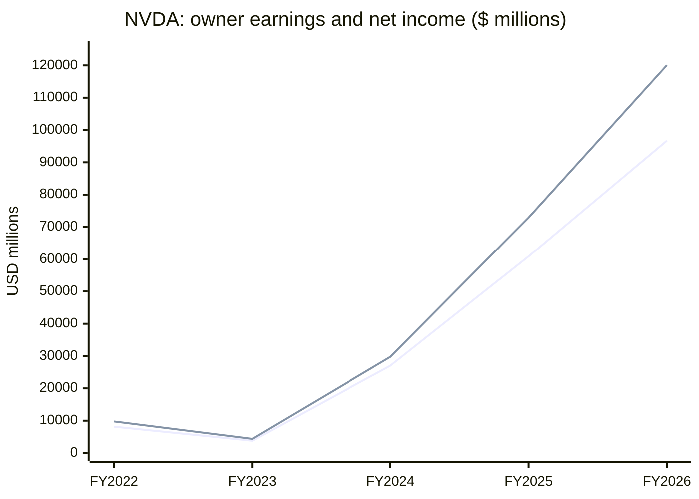

# NVDA — Buffett EDGAR Run Evidence

**Run date:** 3 November 2026

**Ticker:** NVDA (NVIDIA Corporation)

**Data source:** SEC EDGAR company facts, 10-K annual facts only

**Scope:** Business-quality teaching demonstration; no price data, valuation, forecast, or investment advice.

## Executive summary

The fixed review returns **own the business** for NVDA. The code reports a pass for all three predefined checks: ROE cleared the threshold in every displayed year, owner earnings were positive in every year, and owner earnings grew from the first displayed year to the last.

## Rendered app chart

## 10-K fact table

All amounts are USD millions; the latest 10-K filing wins for a duplicated fiscal-year period.

| Fiscal year end | Revenue | Net income | Operating cash flow | Capital spending | Equity | ROE | Owner earnings |
|---|---:|---:|---:|---:|---:|---:|---:|
| 2022-01-30 | 26,914 | 9,752 | 9,108 | 976 | 26,612 | 36.6% | 8,132 |
| 2023-01-29 | 26,974 | 4,368 | 5,641 | 1,833 | 22,101 | 19.8% | 3,808 |
| 2024-01-28 | 60,922 | 29,760 | 28,090 | 1,069 | 42,978 | 69.2% | 27,021 |
| 2025-01-26 | 130,497 | 72,880 | 64,089 | 3,236 | 79,327 | 91.9% | 60,853 |
| 2026-01-25 | 215,938 | 120,067 | 102,718 | 6,042 | 157,293 | 76.3% | 96,676 |

**XBRL tags used:** revenue — `RevenueFromContractWithCustomerExcludingAssessedTax` for the first row and `Revenues` thereafter; net income — `NetIncomeLoss`; operating cash flow — `NetCashProvidedByUsedInOperatingActivities`; capital spending — `PaymentsToAcquireProductiveAssets`; equity — `StockholdersEquity`.

## Fixed Buffett checks

| Check | Result |
|---|---|
| ROE of 15% or more every year | **pass** |
| Owner earnings positive every year | **pass** |
| Owner earnings grew, first year to last | **pass** |

## Memo rendered in the app

> **Verdict: own the business.** The operating record clears all three fixed checks: ROE exceeded the required threshold in every reported year, owner earnings stayed positive, and owner earnings rose from 8,132 to 96,676.

## Memo-number audit

**Rendered result:** `Every number in this memo appears in the script's computed table.`

An injected `40.0%` is flagged because it does not appear in the computed table.

**Primary sources:** [SEC ticker-to-CIK file](https://www.sec.gov/files/company_tickers.json) and [NVDA company facts](https://data.sec.gov/api/xbrl/companyfacts/CIK0001045810.json).
